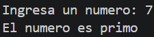

# Programación 1

Repositorio de ejercicios y programas desarrollados durante el curso de Programación 1 de la Licenciatura en Ciencias Computacionales de la Universidad de Sonora.

## Contenido

| Programa | Función |
| --- | --- |
| `palindromo.py` | Captura una cadena de caracteres y determina si es un palíndromo. |
| `primo.py` | Determina si un número ingresado es primo. |
| `triangulo.py` | Calcula el área de un triángulo. |

## Requisitos

- Python 3.
- Visual Studio Code (opcional).
- Git (para administrar el repositorio).


## Cómo ejecutar los programas

Para ejecutar los programas es necesario tener instalado Python 3.

### Programa: Número primo

Este programa permite determinar si un número ingresado por el usuario es primo.

**Requisitos:**
- Tener instalado Python 3.

**Ubicación:** `primo.py`

**Comando para ejecutarlo:**

```bash
python primo.py
```


## Ejemplo de funcionamiento

A continuación se muestra un ejemplo de ejecución del programa `primo.py`.

**Entrada y salida:**

```text
Ingresa un numero: 7
El numero es primo
```
### Captura de ejecución



## Autor

Estudiante de la Licenciatura en Ciencias Computacionales.
Universidad de Sonora.
